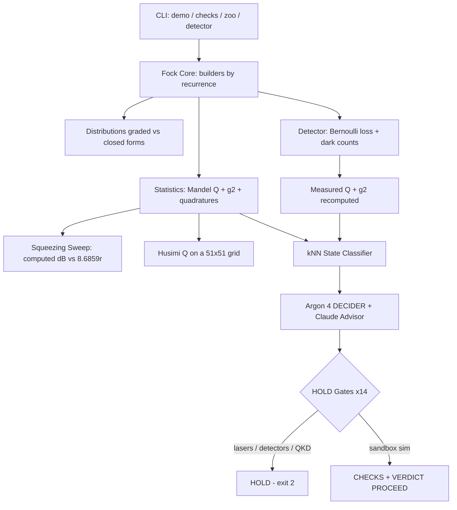
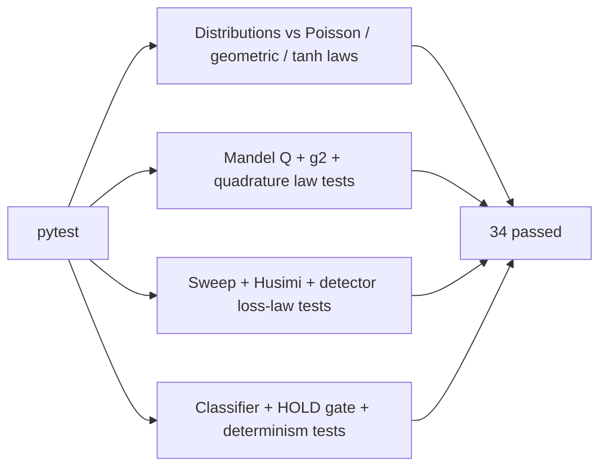
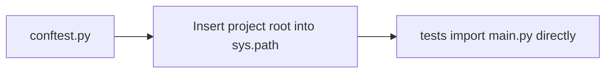
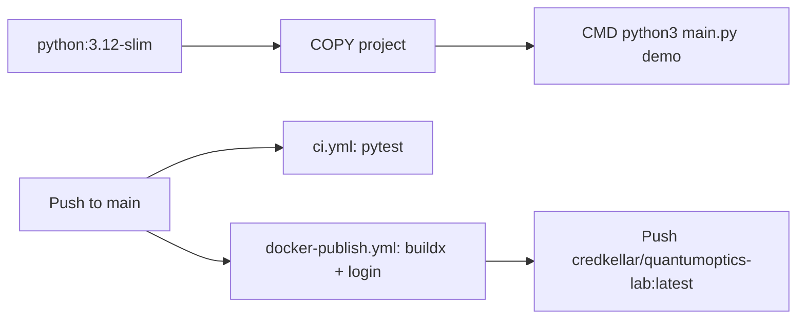

# QuantumOptics-Lab 🔬⚛️

**Single-Mode Quantum Optics Lab** — by Darion Kellar

QuantumOptics-Lab is an **educational single-mode quantum optics lab** in ONE pure-Python file. It builds the standard zoo of one-mode light states from scratch on a **truncated Fock space (n ≤ 40)** — Fock states, a coherent state, thermal light, squeezed vacuum, and a single-photon-added coherent state — and then *characterises* them: photon-number distributions graded against their closed forms, Mandel Q, g²(0), quadrature variances, a squeezing sweep in dB, the Husimi Q function on a grid, and a labelled loss + dark-count detector model. 🔬

One convention, stated once and used everywhere: **x = (a + a†)/√2, p = (a − a†)/(i√2), [x, p] = i** — so the vacuum variance is **1/2 per quadrature** and the Heisenberg floor for the variance product is **1/4**.

Honest scope, stated up front: every state is a vector (or a distribution) **on paper** — no laser was pointed, no detector clicked, no source was certified. Beam-splitter interference (Hong–Ou–Mandel) belongs to **BosonSampling-Lab** and is deliberately **not** redone here; this lab is single-mode state characterisation only. Every hardware / deployment / certification claim sits behind a permanent HOLD gate (14 total). 🔒

[](https://github.com/kimanicollier44-cmyk/QuantumOptics-Lab/actions/workflows/ci.yml)
[](https://github.com/kimanicollier44-cmyk/QuantumOptics-Lab/actions/workflows/docker-publish.yml)

> ℹ️ These are the **live** workflow badges for this repo. They activate as soon as the `ci.yml` and `docker-publish.yml` files from the paste pack are pasted into `.github/workflows/` — until then they have nothing to report yet.

## 🧰 Tech Stack Badges & Full Architecture Tech Stack

### 💻 Core Programming Languages & Core Systems


- 🐍 Python 3.12, pure standard library (`math`, `cmath`, `hashlib`, `json`, `sys`) — zero dependencies, zero network, deterministic (double-run byte-identical)
- 🔢 Fock core from scratch: state builders by recurrence (coherent cₙ₊₁ = cₙ·α/√(n+1); squeezed vacuum from the exact tanh law; photon addition as an explicit a† pass), field moments ⟨a⟩ and ⟨a²⟩ by index arithmetic, and the truncation tail mass reported for every state — never silently dropped
- 📊 Statistics core: photon-number moments → Mandel Q = (Var − ⟨n⟩)/⟨n⟩ and g²(0) = ⟨n(n−1)⟩/⟨n⟩², quadrature variances from ⟨a⟩, ⟨a²⟩, ⟨n⟩ under the stated [x, p] = i convention
- 🌫️ Husimi core: Q(α) = (1/π)|⟨α|ψ⟩|² evaluated point-by-point on a 51×51 grid, with the grid integral printed next to the exact value 1
- 🕶️ Detector core: Bernoulli loss (binomial thinning of P(n)) + independent Poisson dark counts, applied to the distribution itself so measured Q and g² are recomputed, not adjusted by hand
- 🧠 TinyML kNN state classifier (from scratch, stdlib, distance-weighted): sub-poissonian-quantum / coherent-classical-boundary / super-poissonian-thermal / squeezed-nonclassical from (Q, g², min variance ratio), labels from the lab's own policy
- 🪑 Council seats: Gemini Argon 4 DECIDER (names-only, tighten-only) + Muse advisor (never overrides HOLD) + Google Flow plan-only (rendered = False, live = 0)

### ⛓️ Web3 & Infrastructure

- 🚫 **Not applicable — honestly.** No blockchain, no Web3, no tokens: the "infrastructure" in this lab is a truncated Fock space and a labelled detector model inside one offline file. QKD and quantum-network deployment are permanent HOLD gates, not features. No fake badges here.

### ⚙️ Platform Support & Hardware Architecture


- 🖥️ Pure Python — runs anywhere Python 3.12+ runs (Linux, macOS, Windows), plus the `python:3.12-slim` Docker image
- 🔒 No hardware is controlled, ever: real lasers, single-photon detectors, and homodyne setups are permanent HOLD gates (see the gate table below)

### ⚡ Low-Level Infrastructure & Performance

- 🚫 **No low-level code — honestly.** No C, no C++, no GPU, no compiled extensions: this is one interpreted Python file on purpose, so every amplitude can be read, checked, and diffed. Performance here means honest algorithms — recurrences instead of factorials, exact binomial thinning, and a 2,601-point Husimi grid — all deterministic and byte-identical between runs.

### 🛠️ DevOps & Build Tools


- 🐳 Docker (`python:3.12-slim`), GitHub Actions CI + Docker Publish (delivered in the paste pack)
- 🎯 Target image: `credkellar/quantumoptics-lab:latest`
- 🧪 Tests: `pytest` (34 tests) + the built-in CHECKS suite (62 checks) in `main.py`

### ☁️ Cloud Providers

- 🚫 **None — honestly.** No cloud provider is used or needed: the lab runs fully offline on your own machine or in a local Docker container. Docker Hub appears only as the registry the publish workflow pushes the image to.

## What this does?

1. 🏗️ **Builds the state zoo on a truncated Fock space (n ≤ 40)** — vacuum, Fock |1⟩ and |2⟩, coherent |α = √2⟩, thermal (n̄ = 2), squeezed vacuum (r = 1), and a photon-added coherent state a†|α = √2⟩ — each built from scratch by recurrence or by an explicit operator pass, with the truncation tail mass printed for every state (coherent tail < 1e-9; squeezed r = 1 tail 1.98e-06; thermal tail 6.03e-08).
2. 📈 **Grades every distribution against its closed form** — coherent vs Poisson (max error **1.67e-16**), thermal vs the Bose–Einstein geometric law (**2.01e-08**), squeezed vacuum vs the even-only tanh law (**1.28e-06**), with the squeezed odd orders **exactly zero** — photons arrive in pairs or not at all.
3. 🎯 **Computes Mandel Q from the state itself** — Fock |1⟩ lands on **Q = −1 exactly** (the most sub-Poissonian a state can be), coherent light sits on the classical boundary **Q = 0**, thermal light gives **Q = +n̄ = +2.0000**, squeezed vacuum **Q = +3.7598**, and the photon-added coherent state earns **Q = −0.3939** — photon addition makes laser light nonclassical, in numbers.
4. 👯 **Computes g²(0), the antibunching witness** — single photon **0 exactly**, Fock |2⟩ **0.5**, coherent **1**, thermal **2**, squeezed vacuum **3.7225** (against the law 3 + 1/n̄) — the whole classical/nonclassical map from one ratio of moments.
5. 📐 **Measures quadrature variances under one stated convention** — [x, p] = i, vacuum 1/2: Fock |1⟩ is isotropic at 3/2, coherent and vacuum sit on the 1/4 product floor, thermal inflates both quadratures to 2.5, and squeezed vacuum splits them **0.0677 / 3.6943** — quiet in x, loud in p, product still ≈ 1/4.
6. 🔉 **Runs the squeezing sweep in dB** — computed variance ratio vs the closed form 8.6859·r dB: agreement to **0.0017 dB** through r = 1 (8.6842 vs 8.6859), and at r = 1.5 the truncated tail (4.02e-03) visibly bites — the state resolves **10.5307 of the 13.0288 dB**, printed as a shortfall, not hidden.
7. 🌋 **Evaluates the Husimi Q function on a 51×51 grid** — Q(α) ≥ 0 everywhere by construction; the single photon shows its signature **dark centre** (Q(0) = 0 exactly — a crater, not a peak) with grid integral **1.0000**; the squeezed state's integral is **0.9996** and Q(0) = 0.206282 matches 1/(π cosh r), with the finite-box leak stated.
8. 🕶️ **Applies a labelled detector model** — Bernoulli loss + Poisson dark counts (ν = 0.05) applied to the distributions: pure loss leaves **g² exactly invariant** and scales **Q by exactly η** (Fock |1⟩ at η = 0.5 → Q = −0.5), while dark counts drag the single photon's measured g² from **0.093 (η = 1) to 0.360 (η = 0.2)** — toward the classical 1, never past it.
9. 🏷️ **Classifies states with a from-scratch kNN** — (Q, g², min-variance-ratio) features against the lab's own policy: Fock states and the photon-added state → sub-poissonian-quantum, coherent → coherent-classical-boundary, thermal → super-poissonian-thermal, squeezed vacuum → squeezed-nonclassical; kNN == policy asserted on every scenario and all 504 grid rows in CHECKS. (The photon-added state also squeezes a quadrature — ratio 0.778 — and the policy files it under its photon statistics first; the ordering is stated in the code.)
10. 🪑 **Seats the council + runs the built-in CHECKS** — Gemini Argon 4 DECIDER (sha256 trace, tighten-only), Muse advisor (never overrides HOLD), Google Flow plan-only, 14 permanent HOLD gates, and a CHECKS suite (62 checks) that grades every headline number above against its closed form.

## 🗺️ How it works — diagram per script

### `main.py` — the whole lab



### `tests/test_main.py` — verification



### `conftest.py` — test path setup



### `Dockerfile` + CI flow — container & publish



## Why is this cool?

1. 🎯 The single photon's report card is *exact*: Q = −1 and g²(0) = 0 are not approximations or fits — they fall out of the moments of the state the lab built, and CHECKS holds them to 1e-12.
2. 📈 Three distribution shapes, three fingerprints: the Poisson **bell**, the geometric **staircase**, and the squeezed **even-only comb** — plotted on the cover from the lab's own computed P(n), each graded against its closed form to 1.3e-06 or better.
3. 🔉 Squeezing is priced in dB like an engineer would: computed variance vs the 8.6859·r law, agreeing to 0.0017 dB at r = 1 — and the one place the truncation can't keep up (r = 1.5) is printed as a 10.53-of-13.03 dB shortfall with its tail mass next to it.
4. 🌋 The Husimi function makes the single photon *visible*: a crater with an exactly dark centre, Q(0) = 0 — the smoothest possible portrait of the least classical state in the zoo.
5. 🕶️ The detector section teaches the subtlest lesson in photon counting: **loss cannot fake or erase g²** — it is exactly invariant under pure loss — but dark counts quietly drag it classical. Both halves are computed, not asserted.
6. ✨ Photon addition is alchemy with a receipt: shine a† on ordinary laser light and the Mandel Q drops to −0.3939 — a classical state made nonclassical by adding one photon, verified in the moments.
7. 📐 One quadrature convention, stated once, graded everywhere: the squeezed variances land on e^{−2r}/2 and e^{+2r}/2 from the coefficient vector, and the whole zoo respects the 1/4 Heisenberg floor.
8. 🏷️ The classifier's policy is honest about its own edge case: the photon-added state carries two nonclassical signatures, and the filing order (photon statistics first) is written in the code, not buried.
9. ✂️ Truncation is treated as data, not embarrassment: every state reports the probability mass the n ≤ 40 cut discarded, and tolerances in CHECKS are set to those tails — the error bars are part of the output.
10. 🎯 Deterministic end to end: run it twice, get byte-identical output — a quantum optics bench you can diff.

## What problems this solves?

1. ❌ **Problem:** "Sub-Poissonian" and "antibunching" get used as vibes. ✅ **Solution:** Mandel Q and g²(0) are computed from each state's own moments and pinned to their exact values (Q = −1, g² = 0 for |1⟩) in CHECKS.
2. ❌ **Problem:** Photon distributions are usually shown as textbook pictures. ✅ **Solution:** Each P(n) is built by recurrence on the truncated space and graded point-by-point against Poisson / geometric / tanh closed forms, with max errors printed.
3. ❌ **Problem:** Squeezing claims hide behind dB numbers with no convention. ✅ **Solution:** The convention ([x, p] = i, vacuum variance 1/2) is stated once, the variances are computed from the state, and computed dB is printed next to the 8.6859·r law.
4. ❌ **Problem:** Truncation error in Fock-space simulations is silently absorbed. ✅ **Solution:** The discarded tail mass is a printed output per state and per sweep row, and CHECKS tolerances are set to the tails — including the visible r = 1.5 shortfall.
5. ❌ **Problem:** Detector inefficiency is blamed for every washed-out quantum signal. ✅ **Solution:** The model separates the two mechanisms exactly: loss scales Q by η and cannot move g² at all; dark counts are the part that drags g² classical.
6. ❌ **Problem:** The Husimi Q function is described as "always positive, trust us". ✅ **Solution:** It is evaluated on 2,601 grid points, its minimum and its grid integral are printed next to the exact 1, and the single photon's Q(0) = 0 is asserted exactly.
7. ❌ **Problem:** Photon-added states sound like a bookkeeping trick. ✅ **Solution:** a† is applied as an explicit operator pass and the resulting state is re-measured: ⟨n⟩ = 11/3, Q = −0.3939, g² = 0.8926 — nonclassical on two independent witnesses.
8. ❌ **Problem:** Quadrature squeezing and photon statistics get conflated into one "quantumness". ✅ **Solution:** The lab measures both separately and its classifier policy states openly which signature files a state that carries both.
9. ❌ **Problem:** Single-mode labs quietly borrow beam-splitter results (HOM) for glamour. ✅ **Solution:** Interference is explicitly out of scope and left to BosonSampling-Lab; everything here is one mode, characterised completely.
10. ❌ **Problem:** Simulation numbers get quoted as device specs. ✅ **Solution:** 14 named HOLD gates return exit code 2 for laser/detector control, calibration, source certification, QKD, and vendor or advantage claims, forever.

## How to install this?

1. 📋 Clone or download this project folder.
2. 🐍 Make sure Python 3.12+ is installed: `python3 --version`
3. ▶️ Run the full demo + checks (no arguments needed):

```bash
python3 main.py
```

4. 🧪 Run the test suite:

```bash
pip install pytest
python3 -m pytest -q
```

5. 🎛️ Try the other commands:

```bash
python3 main.py checks        # 62 built-in checks
python3 main.py zoo           # state zoo: moments, Q, g2, quadratures (JSON)
python3 main.py distributions # P(n) vs closed forms, max errors (JSON)
python3 main.py squeezing     # squeezing sweep: computed dB vs 8.6859*r (JSON)
python3 main.py husimi        # Husimi grid: min, integral, Q(0) (JSON)
python3 main.py detector      # loss + dark-count table per state (JSON)
python3 main.py classify      # kNN state verdicts
python3 main.py brains        # Argon 4 + Muse + Flow seats
python3 main.py holds         # list all 14 HOLD gates
python3 main.py hold-demo     # exits 2 - gated actions stay HOLD
```

6. 🐳 Or run it in Docker:

```bash
docker build -t credkellar/quantumoptics-lab:latest .
docker run --rm credkellar/quantumoptics-lab:latest
```

## Requirements

- 🐍 Python 3.12 or newer
- 📦 Dependencies: **none** (standard library only)
- 🌐 Network: **none** — fully offline
- 🧪 For tests only: `pytest`
- 🐳 Optional: Docker

## FULL project structure tree

```text
quantumoptics-lab/
├── main.py                  # the whole lab: Fock core, state zoo, distributions, Q/g2 statistics, quadratures, squeezing sweep, Husimi, detector model, classifier, seats, HOLD gates
├── conftest.py              # puts the project root on sys.path for tests
├── tests/
│   └── test_main.py         # 34 pytest tests: distributions, statistics, quadratures, sweep, Husimi, detector laws, gates, determinism
├── assets/
│   └── cover.png            # README cover image (2736 x 912)
├── Dockerfile               # python:3.12-slim, runs the demo
├── .gitignore               # __pycache__/, .pytest_cache/, *.pyc
└── README.md                # this file
```

> 📦 Delivered separately as paste packs (not in this tree): `.github/workflows/ci.yml` + `docker-publish.yml`, and the Docker Hub pack (100-char description, 350-char About, overview, categories).

## 🔒 HOLD gates — all 14, permanent

| # | Gate | What stays held |
|---|------|-----------------|
| 1 | `real_laser_control` | No control of real lasers or light sources; the states here are vectors on paper |
| 2 | `real_detector_operation` | No operating real detectors, SPADs, PMTs, or homodyne hardware |
| 3 | `hardware_specification_claim` | No claiming these teaching numbers are the specification of any real device |
| 4 | `qkd_deployment` | No designing or deploying QKD systems from a statistics lab |
| 5 | `quantum_network_deployment` | No quantum network, repeater, or entanglement-distribution deployment |
| 6 | `vendor_product_claim` | No vendor or product performance claims; no product was measured |
| 7 | `quantum_advantage_claim` | No quantum-advantage claim; this is a classical simulation of one mode |
| 8 | `single_photon_source_certification` | No certifying a real source as a true single-photon source; g2 here is computed, not measured |
| 9 | `detector_calibration_claim` | No real detector calibration or efficiency certification; eta is a labelled model input |
| 10 | `medical_imaging_use` | No medical imaging, diagnostics, or clinical sensing use |
| 11 | `surveillance_sensing_use` | No surveillance, LiDAR, or remote-sensing deployment |
| 12 | `laser_safety_assessment` | No laser-safety or eye-safety assessment for real beams |
| 13 | `cryptographic_security_claim` | No cryptographic security proof from simulated photon statistics |
| 14 | `metrology_record_claim` | No metrology record or standard claim; squeezing here is a labelled parameter, not a measurement |

🧑‍⚖️ **Council seats:** Gemini Argon 4 Extended Thinking — DECIDER (names-only, tighten-only, MAP → MODEL → STRESS → DECIDE, sha256 trace, `can_override_hold = False`) · Muse — advisor (`can_override_hold = False`) · Google Flow — plan-only (`rendered = False`, `live = 0`).

✅ **Verification:** pytest **34 passed** (project + clean copy) · built-in CHECKS **62/62** · double-run output **byte-identical** · `hold-demo` exits **2** · `main.py` **891 lines**, pure stdlib, zero network.

## 🧒 5th-grade English section

Imagine light as a stream of tiny balls called **photons**, and this lab as a counting room for one single beam of light. 🔦

- Some light is like a **perfect metronome**: the photons come out evenly spaced, never bunching up. That is laser light, and its counting pattern makes a neat **bell shape**. This lab builds that pattern and checks it against the math book's answer — they match to the 16th decimal place. 🔔
- Some light is like a **leaky faucet in a storm**: photons bunch up and arrive in clumps. That is hot, thermal light, and its pattern is a **falling staircase** — lots of empty moments, a few big clumps. 💧
- The most special light of all is **one photon at a time** — never two together, ever. The lab gives it a perfect score: the "bunching number" g² is exactly **zero**, something no ordinary lamp can do. 1️⃣
- **Squeezed light** is light that has been hushed in one direction: one kind of wobble gets quieter than empty space itself, but the other wobble must get louder to pay for it — like squeezing a balloon. The lab measures the quiet in decibels: **8.68 dB** of hush. 🎈
- Real detectors are a bit sloppy: they **miss** some photons and sometimes **imagine** one that was never there (a "dark count"). The lab shows something surprising — missing photons cannot fake the special one-at-a-time score, but the imagined ones slowly wash it away. 🕶️
- This project is a **pretend lab on a computer**. It does not shine real lasers or build real detectors. It teaches you how scientists *fingerprint* light — by counting it very, very carefully. 💻

---

MIT © 2026 Darion Kellar · QuantumOptics-Lab — educational simulation only 🔬
